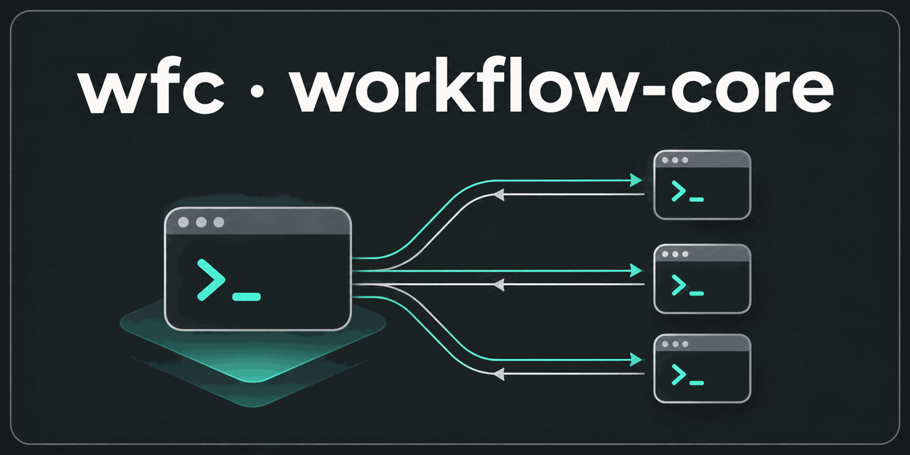
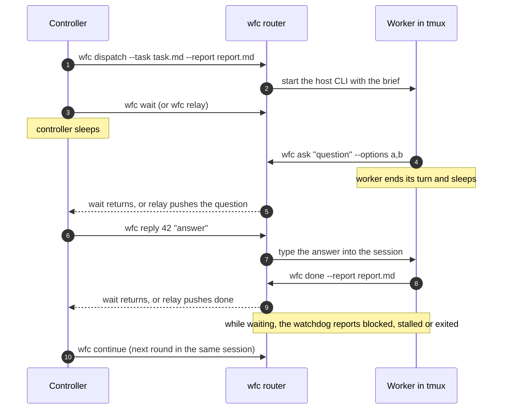

# workflow-core



[](https://github.com/xmxxc/workflow-core/actions/workflows/ci.yml)
[](https://github.com/xmxxc/workflow-core/releases/latest)
[](LICENSE)

**English** · [简体中文](README.zh-CN.md)

**`wfc` is a lightweight router between an AI coding controller and the workers it dispatches to Codex, Claude Code and OpenCode.** Workers report or ask through `wfc` and then sleep; the controller sleeps on `wfc wait` (or is woken by `wfc relay`) until one of them has something to say. It ships as a single command with no dependencies beyond Python and tmux.

## Contents

- [Why workflow-core](#why-workflow-core)
- [How it works](#how-it-works)
- [Features](#features)
- [Quick start](#quick-start)
- [Supported hosts](#supported-hosts)
- [Command reference](#command-reference)
- [Workers and sessions](#workers-and-sessions)
- [State and reliability](#state-and-reliability)
- [Known limitations](#known-limitations)
- [Relationship to super-coding](#relationship-to-super-coding)
- [Project status and roadmap](#project-status-and-roadmap)
- [Development and releases](#development-and-releases)
- [License](#license)

## Why workflow-core

A controller session that hands work to other agents, one implementing and another reviewing, usually ends up polling: it stays awake, re-reads screens and burns context while the workers run. Nobody notices when a worker stops on a prompt, runs out of quota or quietly exits.

`wfc` turns that into message passing:

- The controller dispatches a worker into its own interactive session (a tmux session running the host's normal TUI, not a headless mode), then sleeps.
- The worker finishes with `wfc done` or asks with `wfc ask`, and ends its turn.
- The controller is woken by that message through its host's own entry point: a blocking `wfc wait` for Claude Code, a `wfc relay` that pushes into the session for Codex and OpenCode.
- While the controller sleeps, a watchdog reports workers that stalled, exited or hit a host error, so nothing waits forever.

No resident scheduler and no headless controller are required.

## How it works



1. `wfc dispatch` starts the worker in its own tmux session, `wfc-<dispatch id>`, with a brief that tells it the exact `wfc done` and `wfc ask` commands to run.
2. The controller sleeps. A Claude Code controller runs `wfc wait`, which blocks until a worker message arrives. A Codex or OpenCode controller starts `wfc relay`, which pushes messages into its session through `codex queue` or OpenCode's `prompt_async` HTTP API.
3. A worker that needs a decision runs `wfc ask` and ends its turn; the answer, sent with `wfc reply`, arrives as its next message. A worker that finishes runs `wfc done`.
4. The controller wakes on the message, then answers, reviews the report, gives the same session its next task with `wfc continue`, or dispatches someone else.
5. Messages, dispatches and rounds are kept in SQLite (`router.db`), so `wfc status` can show everything at any time without consuming a message.

## Features

- **One file, three hosts.** Dispatch workers to Codex, Claude Code or OpenCode; any of the three can also be the controller.
- **Sleep, don't poll.** Workers report and ask through `wfc`; the controller is woken by `wait` or `relay`.
- **Same session, next round.** `continue` gives a worker its next task in the same session, so a fix round reuses the implementer and an incremental review reuses the reviewer.
- **Watchdog.** While waiting, the router reports `exited` (the session ended without `done`), `stalled` (the screen was unchanged for `--stall-after` seconds with no pending question) and `blocked` (the turn ended on a host error such as a used-up quota, an overloaded model or a policy refusal), with the screen tail or the host's own error.
- **Git-aware reports.** `done` records the worktree's `head` and `dirty`, so the controller can check the commit a report names.
- **Steering.** `nudge` types one line into a worker still on its task; `reply` answers its question.
- **Recovery.** `resume` relaunches a worker whose session ended into its own host conversation, with the context of earlier rounds.
- **Read-only status.** `status` shows every dispatch, the undelivered messages and the running waiters, without taking a message or touching the database.
- **Opt-in cleanup.** `reclaim` lists finished workers' tmux sessions and closes them only with `--yes`.
- **Careful delivery.** No batch is queued twice and no line is typed twice; a dropped Enter in Codex is pressed again only when the input box proves the text is still there.
- **Per-dispatch options.** Model, reasoning effort, network access and local git commits are set per dispatch through each host's own options and survive `resume`.

## Quick start

### Requirements

- Linux or macOS (on Windows, use WSL2)
- Python 3.9 or later
- tmux
- The host CLIs you dispatch to: [Codex](https://github.com/openai/codex), [Claude Code](https://docs.anthropic.com/en/docs/claude-code), [OpenCode](https://opencode.ai)

### Install

Download `wfc` and `wfc.sha256` from the [latest release](https://github.com/xmxxc/workflow-core/releases/latest), verify the download, and put `wfc` on your `PATH`:

```sh
sha256sum -c wfc.sha256
install -m 755 wfc ~/.local/bin/wfc
wfc --version
```

To build `wfc` from a checkout instead, run `python3 build.py`; it writes `dist/wfc`.

For the full development workflow on top of `wfc`, install the `super-coding` skills from [xmxxc/super-coding](https://github.com/xmxxc/super-coding) (see its README).

### Your first dispatch

Run these from the controller's session. Write the task as a Markdown file and pick a report path; the report's directory is made writable for the worker.

```sh
# start a Claude Code worker in a worktree
wfc dispatch --host claude --task ledger/prompts/1-impl.md \
  --cwd ~/src/app/.worktrees/1-impl --report ledger/reports/1-impl/r1.md

# sleep until a worker sends done, a question, or the watchdog reports it
wfc wait --timeout 900

# answer a question by its message id, or give the same session its next round
wfc reply 42 "use option a"
wfc continue d-1a2b3c4d --task ledger/prompts/1-impl-r2.md --report ledger/reports/1-impl/r2.md

# see everything at any time; watch a worker live with tmux
wfc status --active
tmux attach -t wfc-d-1a2b3c4d   # leave with Ctrl-b d
```

Commands print their result as JSON; `dispatch`, for one, prints the dispatch id, its label and its tmux session.

## Supported hosts

| | Codex | Claude Code | OpenCode |
| --- | --- | --- | --- |
| **Worker launch** | `codex --no-alt-screen -s workspace-write -a never` | `claude --permission-mode auto --add-dir …` | `opencode <worktree>` with every external directory allowed |
| **Sandbox** | `workspace-write`: the worktree, `/tmp`, `$TMPDIR` and the added directories; no network unless `--network` | None; `auto` mode with `--add-dir` | None; directory rules are tool prompts, which shell writes bypass |
| **`--effort`** | `-c model_reasoning_effort=<level>` | `--effort <level>` | `--variant <level>` |
| **`--network`** | `-c sandbox_workspace_write.network_access=true` | Ignored (not network-sandboxed) | Ignored (not network-sandboxed) |
| **`--git`** | Adds the worktree's git directories to `--add-dir` | Ignored (can write `.git` anyway) | Ignored (can write `.git` anyway) |
| **As controller, woken by** | `wfc relay --codex` (through `codex queue`) | `wfc wait` | `wfc relay --opencode-url … --opencode-session …` (through `prompt_async`) |
| **Session title** | Not set (no launch option) | The label, as `--name` | Not set (no launch option) |
| **`resume` finds the conversation in** | Rollouts under `$CODEX_HOME/sessions` | The `--session-id` given at dispatch | `opencode.db` |
| **Host errors (`blocked`) read from** | `task_complete.error` in the rollout | `isApiErrorMessage` in the transcript | `message.data.error` in the session |
| **Read-only session detection** | Yes (Codex 0.167.0 texts) | No known text yet | No known text yet |
| **Dropped Enter pressed again** | Yes, at most twice | No, one Enter | No, one Enter |

Pin `--model` for OpenCode: its default model can be a rate-limited free one.

Host executable paths, explicit runtime argv, environment precedence and launch diagnostics are documented in [Host launch configuration](docs/host-launch.md). Use `dispatch --launch-config launch.json` or `WFC_LAUNCH_CONFIG` when a desktop/background shell or an existing tmux server has a different PATH.

## Command reference

```sh
# controller
wfc dispatch --host codex|opencode|claude --task <task.md> --cwd <worktree> --report <report.md> [--model <model>] [--effort <level>] [--network] [--git] [--label "<project> | <ticket> | <role>"]
wfc wait --timeout 900 [--stall-after 300]   # blocks until a worker message (done, question, blocked, stalled, exited); exit code 3 on timeout
wfc status [--dispatch <id> | --active]   # read-only (never creates or upgrades router.db): dispatches, undelivered messages, running waiters; --dispatch adds its message history; --active lists only unfinished dispatches, plus finished ones with a live tmux session under reclaimable
wfc reclaim [--dispatch <id> ...] [--yes]   # list the sessions of done dispatches (named ones also unfinished); --yes closes them, recording reclaimed
wfc nudge <dispatch> --text "<one line>"   # type a line into a worker that has not finished its task
wfc reply <question-id> "<answer>"
wfc continue <dispatch> --task <next-task.md> --report <next-report.md>   # next round in the same session (report in the same dir)
wfc resume <dispatch> [--task <next-task.md> --report <next-report.md>]   # session ended: relaunch into its own conversation; --task only after done
wfc relay --codex --detach [--stall-after 300]   # Codex controller, run from its own session: push messages into it instead of `wait`; prints the pid
wfc relay --codex-thread <session-uuid> --detach   # same, for a named thread (checked against its rollout)
wfc relay --opencode-url http://127.0.0.1:<port> --opencode-session <ses_id> --detach   # OpenCode controller (started with --port): push messages over its HTTP API

# worker (the dispatch brief tells it these exact commands)
wfc done --report <report.md>   # the done message adds the worktree's head and dirty
wfc ask "<question>" --options a,b
```

`wfc --version` prints the version; `wfc <command> --help` lists a command's options.

### Dispatching

- **`dispatch`** starts a worker. `--report`'s directory is made writable for it.
  - `--model` goes to the host's own model option.
  - `--effort` sets the reasoning effort through each host's own option (levels are the host's own); see [Supported hosts](#supported-hosts).
  - `--network` lets a Codex worker's sandbox reach the network. Claude Code and OpenCode are not network-sandboxed, so it is ignored for them and `dispatch` says so under `ignored`.
  - `--git` (off by default) lets a Codex worker commit; see [Local commits from a Codex worker](#local-commits-from-a-codex-worker). It is ignored for Claude Code and OpenCode, which can write `.git` anyway, and listed under `ignored`.
  - `--label` names the dispatch; see [Labels and titles](#labels-and-titles).
  - `--effort` and `--network` are recorded with the dispatch and kept by `resume`, so no worktree needs its own `.codex/config.toml`. `--git` is recorded, kept by `resume` and shown by `status`.
- **`continue`** gives a worker that finished its task the next one in the same session. The new report must be in the dispatch's report directory.
- **`resume`** relaunches a worker whose session ended into its own host conversation, so it keeps the context of earlier rounds. `--task` and `--report` give it a next task, and only after it is done.

### Waiting

- **`wait`** blocks until a worker message arrives (`done`, a question, `blocked`, `stalled` or `exited`) and exits with code 3 on timeout. `--stall-after` (default 300) is how many seconds a worker's screen may stay unchanged before it is reported `stalled`.
- **`relay`** is the `wait` of a Codex or OpenCode controller: it pushes messages into the controller session instead. `--detach` runs it in a new session with output to `$WFC_STATE/relay.log` and prints its pid and log path; `--for <seconds>` stops it after that long (by default it runs on).
  - `--codex`, run from inside the Codex controller, takes the thread from `$CODEX_THREAD_ID`. `--codex-thread <uuid>` names a thread instead. Both are checked before relay starts; see [Codex thread check](#codex-thread-check).
  - `--opencode-url` and `--opencode-session` deliver over OpenCode's `prompt_async` HTTP API; the OpenCode controller must be started with `--port`.

### Inspecting

- **`status`** shows every dispatch, the messages not yet delivered and the running `wait` or `relay`, without taking any message.
  - It is fully read-only: it opens `router.db` read-only, shows an empty state when there is none, and shows an older database as far as its schema goes (noting so under `schema`). Only write commands create or upgrade the database.
  - `--dispatch <id>` adds that dispatch's whole message history.
  - `--active` lists only the dispatches not yet finished (`working`, `asking` or `exited`); `undelivered` and `waiters` are shown in full as usual. A finished (`done`) dispatch whose tmux session is still alive is not in `dispatches` but in `reclaimable` (`dispatch`, `label`, `tmux`), so the controller can close it with `reclaim` or give it a next task with `continue`. `reclaimable` appears only with `--active`, so plain `status` is unchanged. `--active` cannot be combined with `--dispatch`.
  - A dispatch's last message shows the `head` and `dirty` its `done` recorded.

### Steering workers

- **`reply <question-id> "<answer>"`** types the answer into the worker that asked.
- **`nudge <dispatch> --text "<one line>"`** types one line into a worker still on its task (to continue after the quota is back, say). It is recorded in `router.db`.

### Cleaning up

- **`reclaim`** closes the tmux sessions the router started, only once the user agrees. See [Reclaiming sessions](#reclaiming-sessions).

### Worker commands

- **`done --report <report.md>`** reports the task finished. The message carries `head` (`git rev-parse HEAD` in the dispatch's worktree) and `dirty` (uncommitted or untracked changes there). Both are `null` when the worktree is not a git repository, git fails or a git call takes over 5 seconds (each git call has its own 5-second limit).
- **`ask "<question>" [--options a,b]`** asks the controller; the worker then ends its turn, and the answer arrives as its next message.

## Workers and sessions

### Sandbox and permissions

Workers run unattended. They may write only their worktree, the router state and the report's directory:

- **Codex** uses `-s workspace-write -a never`.
- **OpenCode** allows every external directory, because its directory rules are tool prompts rather than a sandbox (shell writes bypass them), and git or pnpm would otherwise stop it constantly.
- **Claude Code** runs in `auto` mode with `--add-dir`. It asks for trust on every new path, worktrees included, so `dispatch --host claude` pre-trusts the worktree in `~/.claude.json`, but only when the user already trusts one of its parent directories (`trustedBy` in the output). Otherwise the worker stops on the prompt and is reported `stalled`.

The brief also asks the worker to stop any server or background process it started before it reports.

### Local commits from a Codex worker

A Codex worker in a linked worktree cannot `git commit` in its sandbox when the worktree's git directories lie outside all of its writable directories (the worktree, `/tmp`, `$TMPDIR` and the added ones), as they usually do. Adding them made commits work in the layout and version measured in [the probe](docs/probes-20261109-codex-git.md).

`--git` (off by default) does that: it adds the worktree's `git rev-parse --git-dir` and `--git-common-dir`, resolved to absolute paths, to the Codex worker's `--add-dir`, and refuses to dispatch when the worktree is not a git repository.

Its boundary: the worker can then change anything under the main repository's `.git` (other branches, refs, config), not only commit to its own branch. Use it for local commits only. Pushing, opening PRs and posting comments stay with the controller: the sandbox has no network by default, and no credentials.

### tmux sessions

Each worker runs in its own tmux session, `wfc-<dispatch id>`, on the controller's tmux server. The watchdog treats a missing session as `exited`, so the controller and its workers must use the same tmux server and `TMUX_TMPDIR`.

- Watch or step in with `tmux attach -t wfc-<id>`, and leave with Ctrl-b d.
- Some terminals (VS Code's, for one) take Ctrl-b for themselves; then run `tmux detach-client -s wfc-<id>` from another shell.
- Ctrl-C would stop the worker; `resume` brings it back.

### Labels and titles

Each dispatch has a label, `<project> | <ticket> | <role>`.

- By default the project is the main repository's directory (the parent of the worktree's `git rev-parse --git-common-dir`, or the worktree's own name outside git). The ticket and role come from the report directory, `reports/<ticket>-<role>/`, split at its last `-`; a name without `-` is kept whole.
- `--label` overrides it. Newlines and other control characters become spaces, and a label left empty by that gets the default.
- The label is kept in `router.db` and shown by `status`. It names the tmux window: the session stays `wfc-<id>`, tmux stops renaming the window, and the host cannot rename it unless the user's tmux turns on `allow-rename`. It is also the Claude Code session name (`--name`, kept on `resume`).
- Codex and OpenCode titles are not set. Neither has a launch option for it (OpenCode's `--title` is only on `opencode run`), and both can only be renamed once the session exists, through host-internal interfaces (Codex app-server `thread/name/set`, OpenCode `PATCH /session/{id}`). A later version could do that from the watchdog ([probe](docs/probes-20261109-session-title.md)).

### State directory

State is kept in SQLite (`router.db`) under `$WFC_STATE`, which defaults to `~/.local/state/workflow-core`. Each state directory is managed on its own.

## State and reliability

### Message delivery

- **`relay` never queues a batch twice.** When `codex queue` times out or exits non-zero, it may already have taken the batch, so delivery is uncertain: the batch is logged in `relay.log` and not retried (check the controller session). Only a queue that could not start at all (codex missing) is retried. The exception is `codex queue` answering `no rollout found for thread id …`, which means the batch certainly was not delivered: relay puts it back as undelivered, reports the error and exits 1, because every later batch would be lost too.
- **`reply` and `continue` never type a line twice.** When the text reached the worker but its Enter was not confirmed, they stop and ask you to attach and press Enter.

### Dropped Enter (Codex)

A long text can still be arriving when its Enter does, and the TUI then drops the Enter: the text stays in the input box, unsent. For a Codex worker, `reply`, `continue` and `nudge` therefore look at Codex's input box after the check window:

- While the box still holds the typed text, they press Enter again, at most twice, each followed by its own check window (a refusal answering it counts as read-only, as in [Read-only sessions](#read-only-sessions)).
- An Enter is pressed again only when two captures 0.3 s apart show the same box holding the typed text, wrapping ignored: the box must start where the text starts, or, when Codex marks it scrolled (`↑`), show a later part of it.
- A box showing a known placeholder (`INPUT_BOX_PLACEHOLDERS` in `router.py`; Codex 0.167.0 draws `Ask Codex to do anything`) is empty and never compared with the text, which may contain it. A placeholder not in that list is never scrolled and does not start the typed text (which starts with `[router]`), so it gets no Enter either.
- An empty box, a box with other text, or one still changing gets no Enter, so nothing is submitted twice and no empty Enter is sent (an Enter into an empty Codex box does nothing anyway, measured on Codex 0.167.0).
- Text still in the box after the retries is reported like an unconfirmed Enter: the record stays, and you attach and press Enter.

The box is told apart from the transcript, where Codex repeats each submitted message after the same `›`. It is the last paragraph starting with `›` at the left edge (further lines indented two spaces, a tall box marked `↑`/`↓` at its right edge), directly followed by a footer of one or two indented lines joined by ` · `, with at most blank lines between. A screen that does not look like that gets no further Enter.

Claude Code and OpenCode keep one Enter. Their boxes were measured (Claude Code 2.1.322: `❯` between two `─` rules; OpenCode 1.19.5: a `┃`-bordered box closed by `▀`, whose user messages in the transcript carry the same `┃`), but how they look after a submit, with a long paste, or after an Enter into an empty box was not measured, so no rule is trusted to press Enter there ([probe](docs/probes-20261110-input-box.md)).

### Watchdog: blocked, stalled, exited

While `wait` or `relay` runs, the router watches its workers:

- **`exited`**: the session ended without `done` (including a missing tmux session).
- **`stalled`**: the screen was unchanged for `--stall-after` seconds with no pending question. The screen tail is attached.
- **`blocked`**: the worker's turn ended on a host error (a used-up quota, an overloaded model, a policy refusal). It is reported at once with the host's own error kind and message, read from the host's conversation record rather than the screen:
  - the latest turn end of a Codex rollout (`task_complete.error`), a Claude Code transcript under `$CLAUDE_CONFIG_DIR` (default `~/.claude`; `isApiErrorMessage`) or an OpenCode session (`message.data.error`);
  - an error from before the worker's latest dispatch, continue, resume or nudge is not reported;
  - anything unreadable counts as no record, and the screen watchdog remains the fallback.
- **`blocked` with `kind: session_read_only`**: see [Read-only sessions](#read-only-sessions).

The watchdog replaced `notify_controller.py`, the earlier hook-based classifier, which is kept for reference.

### Read-only sessions

A host conversation that can no longer take input drops what is typed into it. (Codex makes every conversation created under the old provider read-only after a provider switch.)

**When typing.** `continue`, `nudge`, `reply` and the brief typed into a resumed OpenCode worker look at the screen around their typing:

- Before typing, a screen that says the conversation is read-only or unavailable gets nothing typed (the Codex banner takes single keys such as `c` and `n` as choices).
- After the Enter, the router watches the screen for 1.5 seconds (`WFC_TYPED_CHECK_SECONDS`) for a state notice (any one on screen counts) or a new refusal (more refusal lines than before the Enter; one left over from an earlier Enter does not count).
- Either way nothing was sent. The command handles it like a send that never arrived (a `continue` restores the round only while it is still the latest; a `nudge` or `reply` drops its record), fails with the host's own line, and says to dispatch a new worker.
- The trade-off: every successful send takes those 1.5 seconds longer, since only a refusal is visible on screen and a send that went through looks the same as one not yet answered.
- A state notice that appears after the window is reported by the watchdog as `blocked` at once. A screen showing only a refusal drawn after it is watched under the usual stall rules (no stall is reported while a question is pending), so it is not guaranteed to be reported as `blocked` at once.

**After a Codex `resume`**, which passes its brief on the command line, the router watches the screen for up to 5 seconds (`WFC_RESUME_CHECK_SECONDS`) and fails the same way when the conversation opens read-only. The resumed round stays recorded, as the session is running. Hosts with no known text are not watched.

**While waiting**, the watchdog reports a screen showing a state notice (`This chat uses …`, `This conversation is unavailable …`) at once as `blocked` with `kind: session_read_only` and the line in `message`, once per screen, without waiting for a stall. A screen a command already reported is not reported again. A refusal only answers one Enter, so the watchdog never takes one for the session's state: a screen with only refusals on it is watched for stalls as usual (the router's own Enters are checked when they are typed).

**The texts**, from Codex 0.167.0 screens measured on 2026-11-09, are in `READ_ONLY_NOTICES` in `router.py`:

- `This chat uses …, but Codex now uses …, so this chat is read-only.` (under `🔒  Continue in a new chat`)
- `This conversation is unavailable. Its cached transcript and draft remain here; input is paused.`
- the refusal of each Enter: `This conversation is read-only or unavailable; no operation was sent.`

Each must start a screen line (after an optional `■ ` or `• `) and may wrap over up to four lines, so a worker quoting it in tool output is not mistaken for the host. Claude Code and OpenCode have no known text yet, so for them the check finds nothing.

### Reclaiming sessions

`reclaim` closes the tmux sessions the router started, only once the user agrees.

- **By default it only lists** the done dispatches whose session is alive (`dispatch`, `label`, `tmux`, `state`, `reclaimable`, `result: listed`) and changes nothing. It opens `router.db` read-only, like `status`.
- **`--yes` closes them** with `tmux kill-session` and records a `reclaimed` message to the worker (never delivered to the controller).
- **An unfinished dispatch** (a stale or read-only session, say) is listed and closed only when named with `--dispatch <id>` (repeatable), and its entry says it is not in `reclaimable`.
- **Ownership check.** Before closing, it checks that the session belongs to this state directory (`tmux show-environment -t wfc-<id> WFC_STATE`). A session of another state directory, or one without `WFC_STATE`, is `refused`.
- **Recheck under lock.** Each close happens under the dispatch's input lock and `router.db`'s write lock, where it checks again. A dispatch `reclaim` chose by itself must still be done and not reclaimed, so one that a `continue` or `resume` gave a new task after it was listed is left running (`changed`). A named dispatch is closed whatever its task's state, since naming it is the user's explicit decision.
- **Results.** A session already gone is skipped (`gone`). A close that fails is `failed` and reported on stderr while the rest go on. With `--yes`, a refused or failed session makes it exit 1.
- **What it leaves alone.** It never touches worktrees, branches, host conversations or `router.db`'s records: the dispatch and its messages stay, because `resume` and the ledger need them. Deleting the whole state directory once the scope is over is the user's call.
- **Afterwards.** `status` shows a reclaimed dispatch with a `reclaimed` field (when it was closed) and the `reclaimed` message as its `last`. An unfinished one shows `state: reclaimed` (a done one stays `done`), and it is no longer in `reclaimable`. The watchdog does not report a reclaimed session as `exited` or `stalled`. `resume` works on a reclaimed dispatch as before (`reclaimed` does not move its round), and watching starts again with it.

### Codex thread check

`codex queue` also succeeds for a thread id that does not exist, so `relay` checks the Codex thread before it starts (in the parent, for `--detach`).

- Run inside the controller, `relay --codex` takes the thread from `$CODEX_THREAD_ID`, which Codex sets for its shell commands and which equals the conversation's rollout id, also after a resume ([probe](docs/probes-20261109-codex-thread-id.md)).
- With either `--codex` or `--codex-thread <uuid>`, relay refuses to start unless `$CODEX_HOME/sessions` holds `rollout-*-<uuid>.jsonl` whose first line names that id and is not a sub-agent's. Only the file named by the id is opened.
- It also refuses when `CODEX_THREAD_ID` is set to a different thread; unset it to relay into another session on purpose. Thread names are refused, because they cannot be checked.
- A thread that passes the check but is not the controller (another top-level conversation) is still accepted, so prefer `--codex`.

### Waiter registration

A running `wait` or `relay` is recorded with its process start, so a pid reused by another process is not listed in `status`.

- **On Linux** that is the starttime in `/proc/<pid>/stat` (clock ticks after boot), which a clock correction does not move, together with the boot id (`/proc/sys/kernel/random/boot_id`), which tells it from a process of an earlier boot. Where the boot id cannot be read it is left out, and a row then names only the pid and starttime, so after a reboot a process with both the same would pass for it.
- **Elsewhere** it is `ps -o lstart`, which is the boot time plus the start offset and so moves when the clock is corrected (a relay registered at 17:15:10 read back as 17:15:07). It therefore matches within 10 seconds, and a pid reused within those seconds would pass for the old process.
- A row registered by wfc up to 0.4.4 holds an lstart and is matched the same way.

### Upgrading

After upgrading `wfc`, a `wait` or `relay` already running is still the old code: restart it (stop it and start it again with the same command) for the new behaviour, such as the waiter check above, to take effect. A `reply` the controller runs uses the new code at once.

## Known limitations

- **Uncertain relay delivery.** A `codex queue` that timed out or exited non-zero is not retried, so a batch may need checking in the controller session (see [Message delivery](#message-delivery)).
- **Unconfirmed Enter.** When `reply` or `continue` cannot confirm an Enter, or Codex's input box still holds the text after the retries, you attach and press Enter yourself. Claude Code and OpenCode get no second Enter.
- **A Codex thread that passes the check is trusted.** `relay --codex-thread` accepts any top-level Codex conversation that passes the [thread check](#codex-thread-check), even one that is not the controller, so prefer `--codex`.
- **`resume` depends on host internals.** It finds a worker's conversation by its first brief: Codex rollouts under `$CODEX_HOME/sessions` (default `~/.codex`), OpenCode's `opencode.db` (`$WFC_OPENCODE_DB`, default under `$XDG_DATA_HOME`), and for Claude Code the `--session-id` the router gives it at dispatch. These are host internals that may change. All three have been verified against real hosts: an OpenCode worker after Ctrl-C, and a Codex and a Claude Code reviewer that had quit, each resumed with its earlier rounds in context. OpenCode ignores `--prompt` on a reopened session, so the router types the brief in once the screen settles.
- **`blocked` depends on host records** in the same internal formats; anything unreadable falls back to the screen watchdog.
- **Read-only detection is Codex-only.** Claude Code and OpenCode have no known read-only text yet. Every successful typed send waits 1.5 seconds for a refusal.
- **Claude Code trust entries.** A running Claude Code session rewrites `~/.claude.json` from memory and can drop a trust entry the router just wrote. If that happens, the worker stops on the trust prompt and is reported `stalled`.
- **`--git` is broad.** A Codex worker dispatched with it can change anything under the main repository's `.git`.
- **No Codex or OpenCode session titles** (see [Labels and titles](#labels-and-titles)).
- **Same tmux server.** The controller and its workers must share the tmux server and `TMUX_TMPDIR`.
- **Running waiters keep old code** after an upgrade until restarted.
- **No native Windows support**; use WSL2.

## Relationship to super-coding

`wfc` is the transport only. The controller skill that drives it, `super-coding` (with its routine-check script), is published separately in [xmxxc/super-coding](https://github.com/xmxxc/super-coding): it carries the development workflow (implementation, review, fix rounds, release) and calls `wfc` to dispatch workers and to be woken. `wfc` can also be used on its own.

The design of `super-coding` is recorded here, in `docs/decision-log.md` and `docs/probes-*.md`.

## Project status and roadmap

The current release routes interactive Codex, Claude Code and OpenCode workers through tmux on Linux and macOS; native Windows support remains a proposed next step.

The product direction confirmed on 2026-11-13 is a small, complete router foundation: execution identity, reliable messages, observation, interruption and recovery. Workflow policies, workers and interfaces build on top; super-coding is the current workflow layer. Issue scanning, review gates and release decisions belong to those callers.

Read the [router foundation and implementation order](docs/router-foundation.md), [source comparison](docs/router-sources-20261113.md) and [native Windows assessment](docs/windows-router-assessment-20261113.md). Proposed backends and protocol paths have not been implemented or verified on Windows. The [documentation index](docs/README.md) and [research validation record](docs/research-validation-20261113.md) are the entry points for a new session.

## Development and releases

### Layout

- `router.py`: the dispatcher (Python standard library only). `tests/test_router.py` covers it through its command line.
- `wfc.py`: the single command. `build.py` packs it with `router.py` into the one-file `wfc` (a Python zip application). `tests/test_wfc.py` covers the build.
- `notify_controller.py`: the earlier hook-based classifier, replaced by the watchdog and kept for reference.
- `docs/decision-log.md`: user decisions, controller decisions and lessons. `docs/probes-*.md`: host capability probes behind the design.
- `docs/assets/banner.png`: the banner at the top of both READMEs.

### Build and test

```sh
python3 -m unittest discover -s tests   # the tests put fake tmux and host CLIs on PATH
python3 build.py                        # writes dist/wfc
```

### CI and releases

- **CI** (`.github/workflows/ci.yml`) runs the tests and a build on Ubuntu and macOS with Python 3.9 and 3.12 for every push to main and every pull request.
- **Releases** (`.github/workflows/release.yml`): set `VERSION` in `wfc.py`, then push a matching tag (`v0.1.0`). The workflow tests, builds `wfc` with its SHA-256 and publishes them as a GitHub Release. Verify a download with `sha256sum -c wfc.sha256`.

### Documents

- [Documentation index](docs/README.md): current direction, source research and validation status.
- [Decision log](docs/decision-log.md): user decisions, controller decisions and lessons.
- [Handoff, 2026-11-04](docs/handoff-20261104-completion-wake.md): decisions made so far, the host wake matrix, the probes to run first, and the directions that were rejected.
- `docs/probes-20261105-*.md`: measured wake and completion behaviour of [Claude Code](docs/probes-20261105-claude-code.md), [Codex](docs/probes-20261105-codex.md), [OpenCode](docs/probes-20261105-opencode.md) and [Orca](docs/probes-20261105-orca.md), plus [completion hooks](docs/probes-20261105-completion-hooks.md).
- [Session title probe, 2026-11-09](docs/probes-20261109-session-title.md): how each host can be given a session title at launch.
- [Codex git probe, 2026-11-09](docs/probes-20261109-codex-git.md): `git commit` from a linked worktree in Codex's `workspace-write` sandbox, with and without its git directories in `--add-dir`.
- [Codex thread id probe, 2026-11-09](docs/probes-20261109-codex-thread-id.md): `CODEX_THREAD_ID` in Codex shell commands, before and after a resume, against the rollout's id.
- [Input box probe, 2026-11-10](docs/probes-20261110-input-box.md): where Codex, Claude Code and OpenCode draw their input box, and how Codex shows a submitted message (#18).

## License

[MIT](LICENSE) © xmxxc
