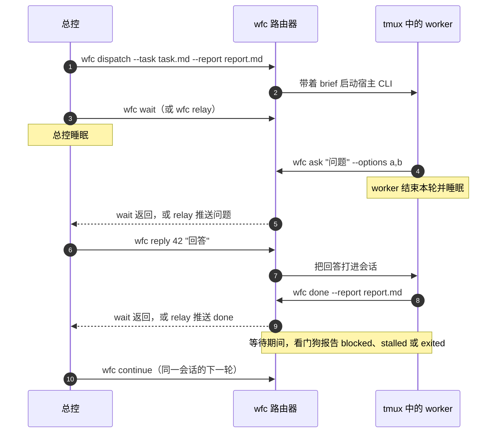

# workflow-core

[](https://github.com/xmxxc/workflow-core/actions/workflows/ci.yml)
[](https://github.com/xmxxc/workflow-core/releases/latest)
[](LICENSE)

[English](README.md) · **简体中文**

**`wfc` 是一个轻量的路由器，连接 AI 编程总控和它派给 Codex、Claude Code、OpenCode 的 worker。** worker 通过 `wfc` 汇报或提问，然后进入睡眠；总控睡在 `wfc wait` 上（或由 `wfc relay` 唤醒），直到某个 worker 发来消息。整个工具只有一个命令，除了 Python 和 tmux 之外没有其他依赖。

## 目录

- [为什么需要它](#为什么需要它)
- [工作原理](#工作原理)
- [特性](#特性)
- [快速开始](#快速开始)
- [支持的宿主](#支持的宿主)
- [命令参考](#命令参考)
- [worker 与会话](#worker-与会话)
- [状态与可靠性](#状态与可靠性)
- [已知限制](#已知限制)
- [与 super-coding 的关系](#与-super-coding-的关系)
- [项目状态与路线图](#项目状态与路线图)
- [开发与发布](#开发与发布)
- [许可证](#许可证)

## 为什么需要它

总控会话把工作交给其他 agent，一个负责实施，一个负责审查。这时总控往往只能轮询：一直醒着，反复看屏幕，在 worker 干活期间白白消耗上下文。worker 停在某个提示上、额度用完或者悄悄退出，也没人发现。

`wfc` 把这件事变成消息传递：

- 总控把 worker 派进它自己的交互式会话（tmux 会话里跑宿主正常的 TUI，不用无头模式），然后睡眠。
- worker 做完就运行 `wfc done`，要提问就运行 `wfc ask`，然后结束这一轮。
- 这条消息通过总控所在宿主自己的入口唤醒总控：Claude Code 用阻塞的 `wfc wait`，Codex 和 OpenCode 用 `wfc relay` 把消息推进会话。
- 总控睡眠期间，看门狗会报告卡住、退出或遇到宿主错误的 worker，不会无限期地等下去。

不需要常驻调度器，也不需要无头总控。

## 工作原理



1. `wfc dispatch` 在 worker 专属的 tmux 会话 `wfc-<dispatch id>` 里启动它，并附上一份 brief，里面写明 worker 要运行的 `wfc done` 和 `wfc ask` 命令。
2. 总控睡眠。Claude Code 总控运行 `wfc wait`，一直阻塞到 worker 消息到达。Codex 或 OpenCode 总控启动 `wfc relay`，它通过 `codex queue` 或 OpenCode 的 `prompt_async` HTTP 接口把消息推进总控会话。
3. 需要决定的 worker 运行 `wfc ask` 并结束本轮；总控用 `wfc reply` 发出的回答会作为它的下一条消息到达。做完的 worker 运行 `wfc done`。
4. 总控被消息唤醒后，可以回答问题、审阅报告、用 `wfc continue` 给同一会话派下一轮，或者另派别人。
5. 消息、dispatch 和轮次都存在 SQLite（`router.db`）里，所以 `wfc status` 随时都能看到全貌，而且不会取走任何消息。

## 特性

- **一个文件，三种宿主。** 可以把 worker 派到 Codex、Claude Code 或 OpenCode；三者也都能当总控。
- **睡眠而不是轮询。** worker 通过 `wfc` 汇报和提问；总控由 `wait` 或 `relay` 唤醒。
- **同一会话接着做下一轮。** `continue` 在同一会话里给 worker 派下一项任务，所以修复轮可以复用实施者，增量复核可以复用审查者。
- **看门狗。** 等待期间，路由器会报告 `exited`（会话结束了但没有 `done`）、`stalled`（画面连续 `--stall-after` 秒没有变化，且没有待回答的问题）和 `blocked`（本轮因宿主错误结束，例如额度用完、模型过载、策略拒绝），并附上画面末尾或宿主自己的错误信息。
- **报告带 git 信息。** `done` 会记录工作树的 `head` 和 `dirty`，总控可以核对报告里说的提交。
- **随时干预。** `nudge` 往还没做完任务的 worker 里打一行字；`reply` 回答它的问题。
- **恢复。** `resume` 把会话已经结束的 worker 重新拉回它自己的宿主对话，保留前几轮的上下文。
- **只读的状态查看。** `status` 列出所有 dispatch、未送达的消息和正在运行的等待进程，既不取走消息，也不改动数据库。
- **清理要明确同意。** `reclaim` 列出已完工 worker 的 tmux 会话，只有加 `--yes` 才关闭。
- **谨慎投递。** 同一批消息不会排队两次，同一行字不会打两次；Codex 吞掉的回车，只有在输入框证明文本还在时才补按。
- **按 dispatch 设置选项。** 模型、推理强度、网络访问和本地 git 提交都可以按 dispatch 设置，通过各宿主自己的参数生效，`resume` 后依然保留。

## 快速开始

### 环境要求

- Linux 或 macOS（Windows 请用 WSL2）
- Python 3.9 或更高版本
- tmux
- 要派发到的宿主 CLI：[Codex](https://github.com/openai/codex)、[Claude Code](https://docs.anthropic.com/en/docs/claude-code)、[OpenCode](https://opencode.ai)

### 安装

从[最新 Release](https://github.com/xmxxc/workflow-core/releases/latest) 下载 `wfc` 和 `wfc.sha256`，校验后把 `wfc` 放到 `PATH` 上：

```sh
sha256sum -c wfc.sha256
install -m 755 wfc ~/.local/bin/wfc
wfc --version
```

也可以从源码构建：运行 `python3 build.py`，产物在 `dist/wfc`。

如果要在 `wfc` 之上使用完整的开发工作流，请从 [xmxxc/super-coding](https://github.com/xmxxc/super-coding) 安装 `super-coding` 技能（见该仓库的 README）。

### 第一次 dispatch

以下命令在总控会话里运行。任务写成一个 Markdown 文件，再选一个报告路径；报告所在目录会对 worker 开放写权限。

```sh
# 在一个工作树里启动 Claude Code worker
wfc dispatch --host claude --task ledger/prompts/1-impl.md \
  --cwd ~/src/app/.worktrees/1-impl --report ledger/reports/1-impl/r1.md

# 睡眠，直到 worker 发来 done 或问题，或者看门狗报告它
wfc wait --timeout 900

# 按消息 id 回答问题，或者在同一会话里派下一轮
wfc reply 42 "用方案 a"
wfc continue d-1a2b3c4d --task ledger/prompts/1-impl-r2.md --report ledger/reports/1-impl/r2.md

# 随时查看全貌；用 tmux 实时观察 worker
wfc status --active
tmux attach -t wfc-d-1a2b3c4d   # 按 Ctrl-b d 离开
```

命令的结果以 JSON 输出；例如 `dispatch` 会输出 dispatch id、标签和 tmux 会话名。

## 支持的宿主

| | Codex | Claude Code | OpenCode |
| --- | --- | --- | --- |
| **worker 启动方式** | `codex --no-alt-screen -s workspace-write -a never` | `claude --permission-mode auto --add-dir …` | `opencode <worktree>`，放行所有外部目录 |
| **沙箱** | `workspace-write`：工作树、`/tmp`、`$TMPDIR` 和追加的目录；不加 `--network` 就不能联网 | 无；`auto` 模式加 `--add-dir` | 无；目录规则只是工具提示，shell 写入可以绕过 |
| **`--effort`** | `-c model_reasoning_effort=<level>` | `--effort <level>` | `--variant <level>` |
| **`--network`** | `-c sandbox_workspace_write.network_access=true` | 忽略（没有网络沙箱） | 忽略（没有网络沙箱） |
| **`--git`** | 把工作树的 git 目录加进 `--add-dir` | 忽略（本来就能写 `.git`） | 忽略（本来就能写 `.git`） |
| **当总控时怎么唤醒** | `wfc relay --codex`（经 `codex queue`） | `wfc wait` | `wfc relay --opencode-url … --opencode-session …`（经 `prompt_async`） |
| **会话标题** | 不设置（没有启动参数） | 标签，作为 `--name` | 不设置（没有启动参数） |
| **`resume` 在哪里找对话** | `$CODEX_HOME/sessions` 下的 rollout | dispatch 时指定的 `--session-id` | `opencode.db` |
| **宿主错误（`blocked`）的来源** | rollout 里的 `task_complete.error` | transcript 里的 `isApiErrorMessage` | 会话里的 `message.data.error` |
| **只读会话检测** | 有（Codex 0.167.0 的文本） | 暂无已知文本 | 暂无已知文本 |
| **补按被吞的回车** | 有，最多两次 | 无，只按一次 | 无，只按一次 |

OpenCode 请固定 `--model`：它的默认模型可能是限流的免费模型。

## 命令参考

```sh
# 总控
wfc dispatch --host codex|opencode|claude --task <task.md> --cwd <worktree> --report <report.md> [--model <model>] [--effort <level>] [--network] [--git] [--label "<project> | <ticket> | <role>"]
wfc wait --timeout 900 [--stall-after 300]   # 阻塞到有 worker 消息（done、提问、blocked、stalled、exited）；超时退出码为 3
wfc status [--dispatch <id> | --active]   # 只读（从不创建或升级 router.db）：dispatch、未送达消息、运行中的等待进程；--dispatch 附带它的消息历史；--active 只列未结束的 dispatch，已完工但 tmux 会话还活着的列在 reclaimable 下
wfc reclaim [--dispatch <id> ...] [--yes]   # 列出已 done 的 dispatch 的会话（点名的也包括未完成的）；--yes 关闭它们并记录 reclaimed
wfc nudge <dispatch> --text "<one line>"   # 往还没做完任务的 worker 里打一行字
wfc reply <question-id> "<answer>"
wfc continue <dispatch> --task <next-task.md> --report <next-report.md>   # 同一会话的下一轮（报告放在同一目录）
wfc resume <dispatch> [--task <next-task.md> --report <next-report.md>]   # 会话已结束：重新拉回它自己的对话；--task 只能在 done 之后用
wfc relay --codex --detach [--stall-after 300]   # Codex 总控，在它自己的会话里运行：把消息推进会话，代替 `wait`；输出 pid
wfc relay --codex-thread <session-uuid> --detach   # 同上，指定线程（会与它的 rollout 核对）
wfc relay --opencode-url http://127.0.0.1:<port> --opencode-session <ses_id> --detach   # OpenCode 总控（以 --port 启动）：通过它的 HTTP 接口推送消息

# worker（dispatch 的 brief 会把这些命令原样告诉它）
wfc done --report <report.md>   # done 消息会附上工作树的 head 和 dirty
wfc ask "<question>" --options a,b
```

`wfc --version` 输出版本号；`wfc <命令> --help` 列出该命令的参数。

### 派发

- **`dispatch`** 启动一个 worker。`--report` 所在的目录会对它开放写权限。
  - `--model` 传给宿主自己的模型参数。
  - `--effort` 通过各宿主自己的参数设置推理强度（取值以宿主为准），见[支持的宿主](#支持的宿主)。
  - `--network` 让 Codex worker 的沙箱可以联网。Claude Code 和 OpenCode 没有网络沙箱，所以对它们忽略这个参数，`dispatch` 会在 `ignored` 下注明。
  - `--git`（默认关闭）让 Codex worker 可以提交，见 [Codex worker 的本地提交](#codex-worker-的本地提交)。Claude Code 和 OpenCode 本来就能写 `.git`，所以对它们忽略，并列在 `ignored` 下。
  - `--label` 给 dispatch 命名，见[标签与标题](#标签与标题)。
  - `--effort` 和 `--network` 随 dispatch 记录，`resume` 时保留，因此不需要给每个工作树单独写 `.codex/config.toml`。`--git` 同样随 dispatch 记录、`resume` 时保留，并在 `status` 里显示。
- **`continue`** 在同一会话里给已完成任务的 worker 派下一项任务。新报告必须放在这个 dispatch 的报告目录里。
- **`resume`** 把会话已结束的 worker 重新拉回它自己的宿主对话，保留前几轮的上下文。`--task` 和 `--report` 用来给它派下一项任务，只能在它 done 之后使用。

### 等待

- **`wait`** 阻塞到有 worker 消息到达（`done`、提问、`blocked`、`stalled` 或 `exited`），超时时退出码为 3。`--stall-after`（默认 300）是 worker 画面可以保持不变的秒数，超过就报 `stalled`。
- **`relay`** 相当于 Codex 或 OpenCode 总控的 `wait`：它把消息推进总控会话。`--detach` 让它在新会话里运行，输出写到 `$WFC_STATE/relay.log`，并打印 pid 和日志路径；`--for <秒数>` 让它运行这么久后停止（默认一直运行）。
  - `--codex` 在 Codex 总控内部运行，从 `$CODEX_THREAD_ID` 取线程。`--codex-thread <uuid>` 则直接指定线程。两种方式在 relay 启动前都会先核对，见 [Codex 线程核对](#codex-线程核对)。
  - `--opencode-url` 和 `--opencode-session` 通过 OpenCode 的 `prompt_async` HTTP 接口投递；OpenCode 总控必须以 `--port` 启动。

### 查看

- **`status`** 列出所有 dispatch、尚未送达的消息和正在运行的 `wait` 或 `relay`，不会取走任何消息。
  - 它完全只读：以只读方式打开 `router.db`；没有数据库时显示空状态；遇到旧版数据库就按它的表结构尽量显示（并在 `schema` 下注明）。只有写命令才会创建或升级数据库。
  - `--dispatch <id>` 附带该 dispatch 的完整消息历史。
  - `--active` 只列尚未结束的 dispatch（`working`、`asking` 或 `exited`）；`undelivered` 和 `waiters` 照常完整显示。已完成（`done`）但 tmux 会话还活着的 dispatch 不在 `dispatches` 里，而是列在 `reclaimable` 下（`dispatch`、`label`、`tmux`），方便总控用 `reclaim` 关闭，或用 `continue` 派下一项任务。`reclaimable` 只在 `--active` 下出现，所以不带参数的 `status` 输出不变。`--active` 不能和 `--dispatch` 同时使用。
  - dispatch 的最后一条消息会显示它的 `done` 记录的 `head` 和 `dirty`。

### 干预 worker

- **`reply <question-id> "<answer>"`** 把回答打进提问的 worker。
- **`nudge <dispatch> --text "<one line>"`** 往还在做任务的 worker 里打一行字（比如额度恢复后让它继续）。这条记录写入 `router.db`。

### 清理

- **`reclaim`** 关闭路由器启动的 tmux 会话，前提是用户同意。见[回收会话](#回收会话)。

### worker 命令

- **`done --report <report.md>`** 报告任务完成。消息附带 `head`（dispatch 工作树里的 `git rev-parse HEAD`）和 `dirty`（那里是否有未提交或未跟踪的改动）。工作树不是 git 仓库、git 出错、或某次 git 调用超过 5 秒（每次 git 调用各有 5 秒上限）时，两者都是 `null`。
- **`ask "<question>" [--options a,b]`** 向总控提问；worker 随后结束本轮，回答会作为它的下一条消息到达。

## worker 与会话

### 沙箱与权限

worker 无人值守地运行，只能写自己的工作树、路由器状态目录和报告所在目录：

- **Codex** 使用 `-s workspace-write -a never`。
- **OpenCode** 放行所有外部目录。它的目录规则只是工具层面的提示，不是沙箱（shell 写入可以绕过），而 git、pnpm 又会频繁触发这些提示，不放行的话 worker 会不停地停下来。
- **Claude Code** 以 `auto` 模式运行，并带上 `--add-dir`。它对每个新路径（包括工作树）都会询问是否信任，所以 `dispatch --host claude` 会在 `~/.claude.json` 里预先信任工作树，但前提是用户已经信任了它的某个上级目录（输出里的 `trustedBy`）。否则 worker 会停在信任提示上，并被报告为 `stalled`。

brief 还会要求 worker 在汇报之前，停掉自己启动的服务或后台进程。

### Codex worker 的本地提交

在链接工作树（linked worktree）里，工作树的 git 目录通常不在 Codex worker 的任何可写目录内（可写目录是工作树、`/tmp`、`$TMPDIR` 和追加的目录），这时 worker 无法在沙箱里 `git commit`。把这些目录加进去之后，在[探针](docs/probes-20261109-codex-git.md)实测的目录布局和版本下可以正常提交。

`--git`（默认关闭）做的就是这件事：它把工作树的 `git rev-parse --git-dir` 和 `--git-common-dir` 解析成绝对路径，加进 Codex worker 的 `--add-dir`；如果工作树不是 git 仓库，就拒绝派发。

它的边界：开启后，worker 能改动主仓库 `.git` 下的任何内容（其他分支、引用、配置），而不只是提交到自己的分支。只把它用于本地提交。推送、开 PR 和发评论仍由总控来做：沙箱默认不能联网，也没有凭据。

### tmux 会话

每个 worker 运行在自己的 tmux 会话 `wfc-<dispatch id>` 里，位于总控所用的 tmux 服务器上。看门狗把找不到的会话当作 `exited`，所以总控和它的 worker 必须使用同一个 tmux 服务器和同一个 `TMUX_TMPDIR`。

- 用 `tmux attach -t wfc-<id>` 观察或介入，按 Ctrl-b d 离开。
- 有些终端（例如 VS Code 的终端）会自己占用 Ctrl-b；这时从另一个 shell 运行 `tmux detach-client -s wfc-<id>`。
- 按 Ctrl-C 会停掉 worker；可以用 `resume` 把它拉回来。

### 标签与标题

每个 dispatch 都有一个标签，格式为 `<project> | <ticket> | <role>`。

- 默认情况下，project 是主仓库的目录名（工作树 `git rev-parse --git-common-dir` 的上一级；不在 git 里时用工作树自己的目录名）。ticket 和 role 取自报告目录 `reports/<ticket>-<role>/`，在最后一个 `-` 处拆开；名字里没有 `-` 时整个保留。
- `--label` 可以覆盖默认值。换行和其他控制字符会变成空格；如果因此变成空标签，就改用默认值。
- 标签保存在 `router.db` 里，`status` 会显示它。它也是 tmux 窗口名：会话名仍是 `wfc-<id>`，tmux 不再自动改窗口名，宿主也改不了，除非用户的 tmux 开启了 `allow-rename`。它还是 Claude Code 的会话名（`--name`，`resume` 时保留）。
- Codex 和 OpenCode 不设置标题。两者都没有对应的启动参数（OpenCode 的 `--title` 只在 `opencode run` 上有），只能在会话建立之后通过宿主内部接口改名（Codex app-server 的 `thread/name/set`，OpenCode 的 `PATCH /session/{id}`）。以后的版本可以由看门狗来做这件事（[探针](docs/probes-20261109-session-title.md)）。

### 状态目录

状态以 SQLite（`router.db`）保存在 `$WFC_STATE` 下，默认是 `~/.local/state/workflow-core`。每个状态目录各自独立管理。

## 状态与可靠性

### 消息投递

- **`relay` 不会把同一批消息排队两次。** `codex queue` 超时或以非零码退出时，它可能已经收下了这批消息，投递结果不确定：这批消息会记进 `relay.log`，不再重试（请到总控会话里确认）。只有根本没能启动的排队（比如找不到 codex）才会重试。例外是 `codex queue` 回答 `no rollout found for thread id …`，这说明消息肯定没送达：relay 会把这批消息退回未送达状态，报告错误并以 1 退出，因为之后的每一批也都会丢。
- **`reply` 和 `continue` 不会把同一行字打两次。** 文本已经到达 worker、但回车没有得到确认时，它们会停下来，请你 attach 进去手动按回车。

### 被吞的回车（Codex）

长文本可能还没传完，回车就先到了，这时 TUI 会吞掉这个回车：文本留在输入框里，没有发出去。因此对 Codex worker，`reply`、`continue` 和 `nudge` 会在核对窗口结束后查看 Codex 的输入框：

- 如果框里还是刚打的文本，就再按一次回车，最多两次，每次之后都有各自的核对窗口（这时出现的拒绝行同样算作只读，见[只读会话](#只读会话)）。
- 只有相隔 0.3 秒的两次抓屏显示同一个输入框、且框里是所打的文本时，才会补按回车（忽略换行）：输入框必须从文本开头开始；如果 Codex 标出了滚动（`↑`），也可以显示文本后面的一段。
- 显示已知占位提示的输入框（`router.py` 里的 `INPUT_BOX_PLACEHOLDERS`；Codex 0.167.0 显示的是 `Ask Codex to do anything`）视为空框，不会拿来和文本比较，因为文本里可能恰好包含这句话。不在列表里的占位提示不会滚动，也不可能是所打文本的开头（所打文本以 `[router]` 开头），所以同样不会补按。
- 输入框为空、是别的文本、或者还在变化时，都不补按回车，因此不会重复提交，也不会发出空回车（在 Codex 0.167.0 上实测，空框里按回车本来也没有反应）。
- 重试之后文本仍在框里的，按回车未确认处理：记录保留，由你 attach 进去按回车。

Codex 会在对话记录里用同样的 `›` 重复显示每条已提交的消息，所以要把输入框和对话记录区分开。输入框是最后一个从行首 `›` 开始的段落（后续行缩进两格；框太高时右边缘有 `↑`/`↓` 标记），紧接着是一到两行用 ` · ` 连接的缩进状态栏，两者之间最多只有空行。画面不符合这个样子，就不再补按回车。

Claude Code 和 OpenCode 仍然只按一次回车。它们的输入框量过（Claude Code 2.1.322：`❯` 夹在两条 `─` 横线之间；OpenCode 1.19.5：以 `┃` 为边框、以 `▀` 收尾的框，对话记录里的用户消息也带同样的 `┃`），但提交之后、长文本粘贴时、以及空框按回车后是什么样子都没有量过，所以在这两个宿主上没有可以信赖的补按规则（[探针](docs/probes-20261110-input-box.md)）。

### 看门狗：blocked、stalled、exited

`wait` 或 `relay` 运行期间，路由器会监视它的 worker：

- **`exited`**：会话结束了，却没有 `done`（包括 tmux 会话已不存在）。
- **`stalled`**：画面连续 `--stall-after` 秒没有变化，且没有待回答的问题。会附上画面末尾。
- **`blocked`**：worker 这一轮因宿主错误而结束（额度用完、模型过载、策略拒绝）。会立即报告，并附上宿主自己的错误类型和原文，这些信息读自宿主的对话记录，而不是屏幕：
  - Codex rollout 最新一轮的结束记录（`task_complete.error`）、`$CLAUDE_CONFIG_DIR`（默认 `~/.claude`）下 Claude Code transcript 里的 `isApiErrorMessage`，或 OpenCode 会话的 `message.data.error`；
  - 早于 worker 最近一次 dispatch、continue、resume 或 nudge 的错误不会报告；
  - 读不到的一律当作没有记录，屏幕看门狗仍然兜底。
- **`blocked` 且 `kind: session_read_only`**：见[只读会话](#只读会话)。

看门狗取代了早先基于钩子的分类器 `notify_controller.py`，后者保留作参考。

### 只读会话

宿主对话一旦不能再接收输入，打进去的字就会被丢掉。（Codex 在切换服务商后，会把旧服务商下创建的所有对话都变成只读。）

**打字时。** `continue`、`nudge`、`reply`，以及打进恢复后的 OpenCode worker 的 brief，都会在打字前后检查画面：

- 打字前，如果画面显示对话只读或不可用，就什么都不打（Codex 的提示横幅会把 `c`、`n` 这样的单个按键当作选项）。
- 按下回车后，路由器在 1.5 秒内（`WFC_TYPED_CHECK_SECONDS`）观察画面，看是否出现状态提示（画面上有就算），或者出现新的拒绝行（拒绝行比回车前多；之前某次回车留下的旧拒绝行不算）。
- 无论哪种情况，都说明什么也没发出去。命令按"从未送达"处理（`continue` 只有在这一轮仍是最新一轮时才回滚；`nudge` 或 `reply` 删掉自己的记录），以宿主的原话报错，并提示改派一个新 worker。
- 代价是：每次成功发送都要多等这 1.5 秒，因为屏幕上只能看到拒绝，已经送达的发送和尚未得到回应的发送看起来一模一样。
- 窗口过后才出现的状态提示，看门狗会立即报为 `blocked`。窗口过后才出现、且画面上只有拒绝行的情况，按普通的 stall 规则监视（有待回答的问题时不报 stall），所以不保证立即报为 `blocked`。

**Codex `resume` 之后**（它通过命令行传入 brief），路由器最多观察画面 5 秒（`WFC_RESUME_CHECK_SECONDS`），如果对话以只读方式打开，就同样报错。恢复的这一轮仍然记录在案，因为会话确实在运行。没有已知文本的宿主不做这项观察。

**等待期间**，看门狗一看到画面上出现状态提示（`This chat uses …`、`This conversation is unavailable …`），就立即报告 `blocked`，`kind` 为 `session_read_only`，`message` 里是那一行原文；同一画面只报一次，不等 stall。命令已经报告过的画面不再重复报告。拒绝行只是对某一次回车的回应，所以看门狗从不把它当作会话状态：画面上只有拒绝行时，照常按 stall 监视（路由器自己按的回车在打字时就已检查过）。

**匹配文本**来自 2026-11-09 实测的 Codex 0.167.0 画面，写在 `router.py` 的 `READ_ONLY_NOTICES` 里：

- `This chat uses …, but Codex now uses …, so this chat is read-only.`（位于 `🔒  Continue in a new chat` 之下）
- `This conversation is unavailable. Its cached transcript and draft remain here; input is paused.`
- 每次回车得到的拒绝：`This conversation is read-only or unavailable; no operation was sent.`

每条文本都必须位于屏幕行首（前面可以有 `■ ` 或 `• `），最多可以折成四行，这样 worker 在工具输出里引用这些话时，不会被误认为是宿主发出的。Claude Code 和 OpenCode 暂无已知文本，所以对它们这项检查什么也找不到。

### 回收会话

`reclaim` 关闭路由器启动的 tmux 会话，前提是用户同意。

- **默认只列出**会话仍然活着的已 done 的 dispatch（`dispatch`、`label`、`tmux`、`state`、`reclaimable`、`result: listed`），不做任何改动。它和 `status` 一样以只读方式打开 `router.db`。
- **加 `--yes` 才关闭**：用 `tmux kill-session` 关掉会话，并记录一条发给 worker 的 `reclaimed` 消息（这条消息永远不会投递给总控）。
- **未完成的 dispatch**（比如陈旧或只读的会话）只有用 `--dispatch <id>` 点名（可重复）时才会列出和关闭，它的条目会注明它不在 `reclaimable` 里。
- **归属核对。** 关闭前，先核对会话是否属于当前状态目录（`tmux show-environment -t wfc-<id> WFC_STATE`）。属于其他状态目录、或者没有 `WFC_STATE` 的会话，结果为 `refused`。
- **加锁复核。** 每次关闭都在该 dispatch 的输入锁和 `router.db` 的写锁之内进行，并在锁内再检查一次。`reclaim` 自己挑出来的 dispatch 必须仍然是 done 且尚未回收；如果列出之后被 `continue` 或 `resume` 派了新任务，就保留它继续运行（`changed`）。点名的 dispatch 不论任务状态如何都会关闭，因为点名本身就是用户的明确决定。
- **结果。** 已经不存在的会话跳过（`gone`）。关闭失败的记为 `failed`，在 stderr 上报告，其余照常进行。加 `--yes` 时，只要有 refused 或 failed 的会话，就以 1 退出。
- **不碰的东西。** 它从不改动工作树、分支、宿主对话或 `router.db` 里的记录：dispatch 和它的消息都保留，因为 `resume` 和账本还要用到。范围结束后是否删除整个状态目录，由用户决定。
- **回收之后。** `status` 会给已回收的 dispatch 加上 `reclaimed` 字段（关闭时间），它的 `last` 是那条 `reclaimed` 消息。未完成的显示 `state: reclaimed`（已 done 的仍显示 `done`），并且不再出现在 `reclaimable` 里。看门狗不会把已回收的会话报为 `exited` 或 `stalled`。`resume` 对已回收的 dispatch 照常可用（`reclaimed` 不会推进它的轮次），恢复后重新开始监视。

### Codex 线程核对

`codex queue` 对不存在的线程 id 也会返回成功，所以 `relay` 在启动前会先核对 Codex 线程（使用 `--detach` 时由父进程核对）。

- 在总控内部运行时，`relay --codex` 从 `$CODEX_THREAD_ID` 取线程。Codex 会为它执行的 shell 命令设置这个变量，其值等于该对话的 rollout id，resume 之后也是如此（[探针](docs/probes-20261109-codex-thread-id.md)）。
- 无论用 `--codex` 还是 `--codex-thread <uuid>`，只有当 `$CODEX_HOME/sessions` 里存在 `rollout-*-<uuid>.jsonl`、其首行写的正是这个 id、且不属于子代理时，relay 才会启动。它只打开 id 对应的那个文件。
- 如果 `CODEX_THREAD_ID` 指向另一个线程，relay 也会拒绝；确实要推送到另一个会话时，先 unset 这个变量。线程名一律拒绝，因为无法核对。
- 通过了核对、但并非总控的线程（另一个顶层对话）仍会被接受，所以优先使用 `--codex`。

### 等待进程的登记

运行中的 `wait` 或 `relay` 会连同进程启动时间一起登记，这样被其他进程复用的 pid 不会出现在 `status` 里。

- **在 Linux 上**，登记的是 `/proc/<pid>/stat` 里的 starttime（开机后的时钟滴答数），校时不会改变它；再加上 boot id（`/proc/sys/kernel/random/boot_id`），用来和上一次开机时的进程区分开。读不到 boot id 时就省略它，这时登记只包含 pid 和 starttime，重启后两者恰好相同的进程会被当成原进程。
- **在其他平台上**，用的是 `ps -o lstart`，它等于开机时间加上启动偏移，因此校时后会变化（一个在 17:15:10 登记的 relay，读回来变成了 17:15:07）。所以比对时允许 10 秒误差，在这几秒内被复用的 pid 会被当成原进程。
- wfc 0.4.4 及以前登记的记录保存的是 lstart，也按同样方式比对。

### 升级

升级 `wfc` 之后，已经在运行的 `wait` 或 `relay` 仍是旧代码：要让新行为（比如上面的等待进程核对）生效，需要重启它（停掉后用同一条命令重新启动）。总控运行的 `reply` 会立即使用新代码。

## 已知限制

- **relay 投递可能不确定。** 超时或以非零码退出的 `codex queue` 不会重试，因此可能需要到总控会话里确认这批消息（见[消息投递](#消息投递)）。
- **回车未确认。** `reply` 或 `continue` 无法确认回车，或者重试后 Codex 输入框里仍有文本时，需要你 attach 进去自己按回车。Claude Code 和 OpenCode 不会补按回车。
- **通过核对的 Codex 线程即被信任。** `relay --codex-thread` 接受任何通过[线程核对](#codex-线程核对)的顶层 Codex 对话，哪怕它不是总控，所以优先使用 `--codex`。
- **`resume` 依赖宿主内部数据。** 它按第一份 brief 找到 worker 的对话：Codex 用 `$CODEX_HOME/sessions`（默认 `~/.codex`）下的 rollout，OpenCode 用 `opencode.db`（`$WFC_OPENCODE_DB`，默认在 `$XDG_DATA_HOME` 下），Claude Code 用路由器在 dispatch 时指定的 `--session-id`。这些都是宿主的内部实现，可能会变。三种宿主都在真机上验证过：一个被 Ctrl-C 结束的 OpenCode worker，以及已经退出的一个 Codex 审查者和一个 Claude Code 审查者，恢复后都带着前几轮的上下文。OpenCode 重新打开会话时会忽略 `--prompt`，所以路由器等画面稳定后再把 brief 打进去。
- **`blocked` 依赖宿主记录**，格式同样是宿主内部的；读不到时退回屏幕看门狗。
- **只读检测只支持 Codex。** Claude Code 和 OpenCode 暂无已知的只读文本。每次成功的打字发送都要多等 1.5 秒，看是否被拒绝。
- **Claude Code 的信任记录。** 运行中的 Claude Code 会话会用内存里的内容重写 `~/.claude.json`，可能把路由器刚写入的信任记录冲掉。一旦发生，worker 会停在信任提示上，并被报告为 `stalled`。
- **`--git` 的权限很宽。** 用它派发的 Codex worker 能改动主仓库 `.git` 下的任何内容。
- **Codex 和 OpenCode 没有会话标题**（见[标签与标题](#标签与标题)）。
- **必须是同一个 tmux 服务器。** 总控和它的 worker 必须共用 tmux 服务器和 `TMUX_TMPDIR`。
- **升级后，运行中的等待进程仍是旧代码**，重启后才会更新。
- **不支持原生 Windows**；请使用 WSL2。

## 与 super-coding 的关系

`wfc` 只负责传递消息。驱动它的总控技能 `super-coding`（连同它的例行检查脚本）单独发布在 [xmxxc/super-coding](https://github.com/xmxxc/super-coding)：它承载开发工作流（实施、审查、修复轮、发布），并调用 `wfc` 派发 worker、被 worker 唤醒。`wfc` 也可以单独使用。

`super-coding` 的设计记录也放在本仓库的 `docs/decision-log.md` 和 `docs/probes-*.md` 里。

## 项目状态与路线图

第一阶段已经可用。xmxxc/example-project 的三张票已经用它走完了派发、审查、发布和真实验收的全过程。

1. **完工唤醒**：worker 或审查者做完后，通过宿主自己的入口唤醒总控窗口。不需要常驻调度器，也不需要无头总控。
2. **不同角色用不同宿主**：GPT 跑在 Codex CLI 里，Claude 跑在 Claude Code 里，其他模型跑在 OpenCode 里。
3. **独立运行**：总控扫描 `ready-for-agent` 的 issue，先以观察模式运行。
4. **更轻的总控**：机械性的工作移到代码里。
5. **更多唤醒来源**：Hermes 网关、MCP 和面板。

每个阶段都建立在前一阶段之上，每个阶段也都可以单独使用。

## 开发与发布

### 目录结构

- `router.py`：调度器（只用 Python 标准库）。`tests/test_router.py` 通过它的命令行测试它。
- `wfc.py`：唯一的命令入口。`build.py` 把它和 `router.py` 打包成单文件 `wfc`（一个 Python zip 应用）。`tests/test_wfc.py` 测试打包。
- `notify_controller.py`：早先基于钩子的分类器，已被看门狗取代，保留作参考。
- `docs/decision-log.md`：用户决定、总控决定和教训。`docs/probes-*.md`：设计所依据的宿主能力探针。

### 构建与测试

```sh
python3 -m unittest discover -s tests   # 测试会把假的 tmux 和宿主 CLI 放到 PATH 上
python3 build.py                        # 生成 dist/wfc
```

### CI 与发布

- **CI**（`.github/workflows/ci.yml`）在每次推送到 main 和每个 pull request 时，在 Ubuntu 和 macOS 上用 Python 3.9 和 3.12 运行测试并构建。
- **发布**（`.github/workflows/release.yml`）：先在 `wfc.py` 里设置 `VERSION`，再推送对应的标签（如 `v0.1.0`）。工作流会运行测试、构建 `wfc` 及其 SHA-256，并作为 GitHub Release 发布。下载后用 `sha256sum -c wfc.sha256` 校验。

### 文档

- [决策日志](docs/decision-log.md)：用户决定、总控决定和教训。
- [交接，2026-11-04](docs/handoff-20261104-completion-wake.md)：当时已做的决定、各宿主的唤醒矩阵、需要先做的探针，以及被否决的方向。
- `docs/probes-20261105-*.md`：实测的唤醒和完工行为，包括 [Claude Code](docs/probes-20261105-claude-code.md)、[Codex](docs/probes-20261105-codex.md)、[OpenCode](docs/probes-20261105-opencode.md)、[Orca](docs/probes-20261105-orca.md)，以及[完工钩子](docs/probes-20261105-completion-hooks.md)。
- [会话标题探针，2026-11-09](docs/probes-20261109-session-title.md)：各宿主能否在启动时设置会话标题。
- [Codex git 探针，2026-11-09](docs/probes-20261109-codex-git.md)：在 Codex 的 `workspace-write` 沙箱里，从链接工作树执行 `git commit`，分别在 `--add-dir` 包含和不包含 git 目录的情况下。
- [Codex 线程 id 探针，2026-11-09](docs/probes-20261109-codex-thread-id.md)：Codex shell 命令里的 `CODEX_THREAD_ID`，在 resume 前后与 rollout id 的对照。
- [输入框探针，2026-11-10](docs/probes-20261110-input-box.md)：Codex、Claude Code 和 OpenCode 把输入框画在哪里，以及 Codex 如何显示已提交的消息（#18）。

## 许可证

[MIT](LICENSE) © xmxxc
