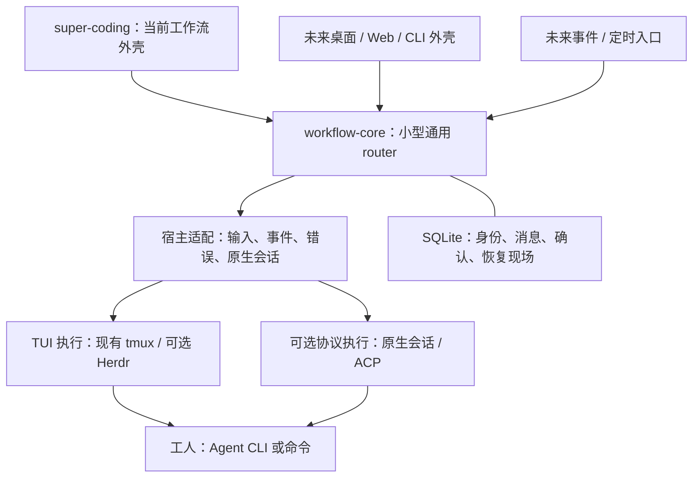

# Router foundation and implementation order

状态：2026-11-13 用户确认产品方向；实现次序与接口形状为本次建议，尚未实施。当前运行时仍是 wfc 0.4.5；super-coding 0.5.1 是独立上层版本。后续会话先读本页与[资料索引](README.md)，再看[验证状态](research-validation-20261113.md)。

## 产品定位：自动化工厂的运输与执行基础

workflow-core 是小型、完整、可单独使用的通用 router。它像工厂的机械臂和传送带：启动指定工人，准确交付任务和回答，收回结果，发现异常，保留可恢复现场，把需要决定的事情交给调用方。完整指这些调度闭环可用且可恢复，不以集成 IDE、模型策略和业务流程的数量衡量。

工人、外壳与工厂流程建立在 router 之上。目前 super-coding 是一个上层工作流与临时外壳，负责开发流程；未来可以有别的技能、CLI、桌面、Web、定时或事件入口。任何一个外壳都不应成为使用 wfc 的前提。

### 核心与上层的职责

| workflow-core 核心 | 工人/宿主或后端 | 上层工厂/外壳 |
|---|---|---|
| scope、dispatch、round/attempt 身份和归属 | 实际执行任务、宿主原生会话 | 需求、票据、业务依赖与并行策略 |
| 任务输入、提问/回答、结果与通用附件引用 | 模型选择执行、工具、沙箱和权限机制 | 选择实施者/审查者、预算和备用策略 |
| 持久消息、送达证据、确认、重放、唤醒 | PTY、结构化协议、屏幕/事件观察 | Standards/Spec 审查、证据放行与发布规则 |
| 活动与阻塞观察、取消、恢复/接替、显式回收 | 原生会话中断、恢复、退出 | GitHub/其他 tracker、PR、合并、部署与真实验收 |
| 可读/机器可读状态和能力查询 | 平台终端、进程和文件系统设施 | UI、通知、cron、团队协作与业务授权 |

路由器可以执行调用方明确选择的动作，但不自行发明角色政策、批准业务操作或把 idle/退出码等同任务满足要求。现有 Git HEAD/dirty 是工作树观察值；审查候选、测试是否足够、PR 是否可合并仍由上层判断。

图中“未来/可选”均为候选，当前 wfc 没有这些新增后端。

## 先补什么

按依赖交付，每步独立可验收，不先做完整插件框架或全面重写。可以并行做源码探针，正式实现保持候选可核对。

| 顺序 | 补齐内容 | 主要借鉴 | 交付与验收依据 |
|---|---|---|---|
| **1 · 运行与消息身份** | dispatch 内显式轮次/执行尝试；持久区分待送、发送未知、已接收和调用方已处理；scope 控制者归属；只读重放/导出 | Orca 的 delivery/ACK、consumer generation 与 mutation receipt；Agent Autoloop 的 claim/回执摘要；LobeHub 的 operation cursor | 崩溃点前后可回读同一事件；重复回报不重复生效；未确认事件可对账；新旧控制者不能同时派发；不宣称业务副作用全局 exactly-once |
| **2 · 活动、阻塞与接替** | 区分进程在线、宿主活动、工具在途、等待回答、未知结果；有期限等待；显式中断与 close 分开；保留任务快照、现场和接替链 | Octopus 多信号 stall；Autoloop 的 unknown 与 started 分支；Codeg 的取消/完成竞态 | 计时器刷新不无限遮蔽挂起；合法静默不自动杀；跨宿主接替先处理旧进程写入归属；不能把失败当没开工直接重做 |
| **3 · 小型后端与平台接口** | 封装现有 tmux 为第一个终端后端，保留已有命令语义；隔离文件锁、进程身份、detach、路径/命令和编码 | Herdr 的终端/进程平台实现；Codeg/Autoloop 的 Windows 启动案例 | Unix 回归保持；旧 dispatch 固定原后端；Windows 可导入并运行 help/version/只读状态；状态与输入契约不依赖 UI |
| **4 · 原生 Windows 闭环** | 先试 Herdr 终端后端，完成一个宿主的派发→提问→回答→完成→续派→恢复→回收；再扩其他宿主 | Herdr 的 ConPTY/Named Pipe/输入与恢复 | 真实 Windows、无 WSL 的成功/中断/并发/所有权测试；后端事件历史缺口能快照对账；不以启动成功代替完整支持 |
| **5 · 可选协议执行** | 有实际需求时增加结构化宿主/ACP 路径，共用同一 router 身份与确认层 | LobeHub 的原生 thread/turn；Paseo 生命周期；Codeg ACP manager | 明确 native session / turn ID、发送和取消确认、断线恢复；TUI 与协议行为差异由能力标记展示 |
| **6 · 外部入口和控制台** | 按需求桥接事件、群聊、远程工作台；复用核心而不再造调度主责 | Autoloop、Orca、Paseo、Codeg、LobeHub；Pachat 的通知/群组入口 | 外层输入有来源和授权上下文；不能把启动回执当完工；同范围保持一个控制者；不让通知消息直接批准生产动作 |

1、2 是本轮最高优先级可靠性补齐；3、4 为 Windows 最短候选路线。若真实 Herdr 探针失败，再比较 Paseo/Codeg 的执行服务接口，避免在未验证前同时实现多个新后端。

### 保持小型的实现约束

- 核心继续优先 Python 标准库 + SQLite，单命令分发；外部终端程序作为可选运行依赖，按能力选择，不把整座桌面/中台搬入核心。
- 分开两个实际变化点：**终端后端**负责 create/inspect/read/submit/interrupt/close；**宿主适配**负责 argv、原生 session、错误与活动事件。平台薄层只处理操作系统差异。
- 后端返回确定未发送、已接受、未知等通用结果；界面名字、pane 名与 PID 不作为稳定任务身份。终端接受不等于模型接收，更不等于任务完成。
- 不为了本轮新增大量 CLI 子命令：先让已有动作共用内部契约，按恢复和外壳调用需求再暴露最小接口。
- 持久状态可升级并保留旧读法；先保持 tmux 兼容，再验证新后端。对外 JSON 字段/退出码的兼容性随实现候选明确。
- 核心记录通用任务/报告/附件身份和内容摘要；业务候选、评审政策和 tracker 对账由上层拥有，避免将 super-coding 的开发专用逻辑并入核心。

## Windows 选择

**建议先用 Herdr 作为可选终端底座，再补 wfc 自己的平台薄层。** 它最接近现有可 attach 的 TUI 路线，能委托 PTY 与终端持久运行。选择依据和待测矩阵在[Windows 评估](windows-router-assessment-20261113.md)。

不能直接替换一个 tmux 命令就声称完成 Windows：当前有顶层 fcntl、Unix 探活、detach、shell quoting、文本编码、权限与分发假设。后端支持 Windows、router 核心可移植、每个宿主完整闭环、原生打包与真实机器验证是不同证据。

Paseo/Codeg 的运行服务可作为后续替代候选，但依赖与生命周期更大；Orca 更适合作上层工作台或外部执行系统。Octopus 当前原生路线为 Linux/macOS，不能拿其 WSL 使用方式证明原生 Windows。Tern.build 的公开发行平台与 Pachat listener 也不构成本轮原生 Windows 底座。

## 记录与接手

本次不实现运行时、不安装后台服务、不注册外部账号、不修改宿主权限配置。源码研究证据与来源版本已保存在本仓，外部 clone 目录和聊天记录不是继续工作的必要条件。

接手顺序：

1. 读本页，[资料索引](README.md)、[外部实现比较](router-sources-20261113.md)、[Windows 评估](windows-router-assessment-20261113.md)。
2. 看[来源固定清单](research-source-pins-20261113.json)与[验证状态](research-validation-20261113.md)，区分源码观察、旧探针和本轮真实执行。
3. 回读 [router.py](../router.py)、[当前测试](../tests/test_router.py)、[历史决策](decision-log.md)，确认期间是否已有修复，按原因重新评估每个建议。
4. 从顺序 1 中选一个可贯穿的最小实现：一次输入、一次回报及它们的重复/崩溃路径；先写明确契约，再实施与独立审查。用户当前授权是方向整理、研究和文档留存，功能实现与正式发布另按具体任务推进。
